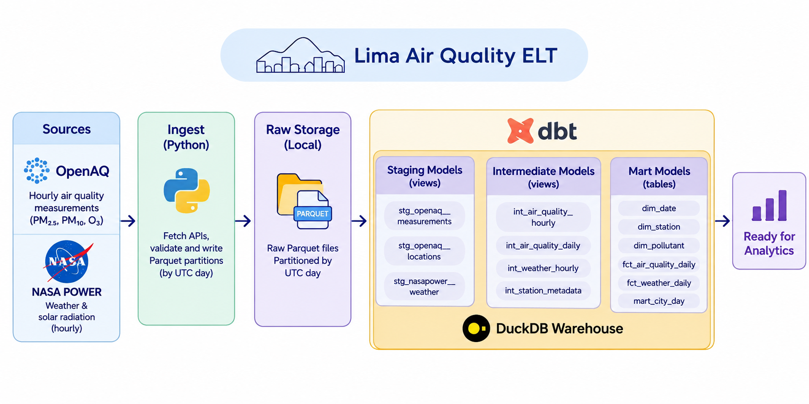
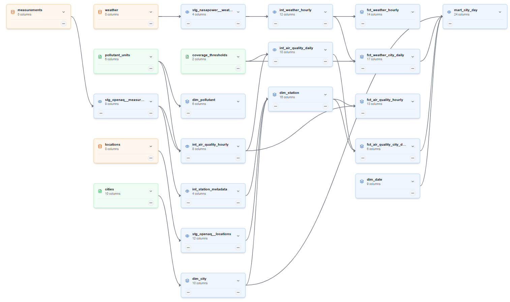

# Lima Air Quality ELT

Un pipeline ELT local que combina mediciones de calidad del aire a nivel de calle de OpenAQ con datos meteorológicos y radiación solar de NASA POWER, y publica un star schema city-day en DuckDB mediante dbt. El entregable es el modelo de datos: dimensions, facts, tests y documentación ejecutable.



## Preguntas de investigación

1. ¿Cómo varían los niveles de ozono y material particulado en días con diferente radiación solar?
2. ¿Cómo se relacionan las condiciones meteorológicas (viento, humedad, temperatura, precipitación, presión) con el material particulado?

Ambas se responden a nivel de **city-day grain** para Lima Metropolitana: la contaminación de la ciudad en su conjunto (media con igual peso entre estaciones que pasan un coverage threshold) contra un único punto de exposición de NASA POWER, porque una sola celda de la grilla cubre toda la ciudad.

## Arquitectura del pipeline

| Etapa | Capa | Qué ocurre |
|---|---|---|
| **Ingest** (Python) | Bronze | Obtiene las APIs, valida y escribe una partición Parquet por día UTC en `data/raw`. La capa raw conserva las respuestas de la API tal cual en una columna `payload`. Re-ejecutar un día reemplaza atómicamente solo esa partición. |
| **Transform** (dbt) | Silver | Staging aplana los payloads en views tipadas. Intermediate aplica las reglas de negocio: selección de sensor, validez física y coverage. Staging e intermediate son views. |
| **Publish** (dbt) | Gold | Tables reconstruidas en cada `dbt build`: dimensions conformadas, facts horarios, facts agregados city-daily y una serving view. `mart_city_day` es la única serving view. |

`dbt build` ejecuta seeds, models y tests en orden de dependencia. No hay models incrementales: cada table se reconstruye desde la capa raw.

## Estructura del proyecto

```
proj/
|-- src/
|   |-- main.py                 # entrypoint de la CLI y orquestación de la corrida
|   |-- ingest.py               # discovery, ingest de OpenAQ y NASA POWER
|   `-- exceptions.py           # fallos y exit codes
|-- dbt/
|   |-- dbt_project.yml
|   |-- profiles.yml
|   |-- macros/
|   |   `-- generate_schema_name.sql
|   |-- seeds/
|   |   |-- cities.csv
|   |   |-- coverage_thresholds.csv
|   |   `-- pollutant_units.csv
|   |-- models/
|   |   |-- staging/            # views: un model por fuente
|   |   |-- intermediate/       # views: limpieza, joins y reglas de negocio
|   |   `-- marts/              # dimensions, facts y la serving view
|   `-- tests/                  # tests singulares de dbt
|-- tests/
|   |-- conftest.py             # agrega src/ al path de pytest
|   `-- test_ingest_discovery.py
|
|-- data/
|   |-- raw/                    # particiones Parquet y el snapshot de locations
|   |-- _state/                 # logs del ingest
|   `-- warehouse.duckdb        # base analítica local
|-- images/
|-- pyproject.toml
|-- README.md
`-- README.es.md
```

## Fuentes

| Fuente | Qué provee | Notas |
|---|---|---|
| [OpenAQ v3](https://docs.openaq.org/) | Mediciones horarias por sensor (`pm25`, `pm10`, `o3`) de estaciones fijas dentro del bounding box de Lima, más el catálogo de locations que se refresca en cada corrida | API key requerida (`OPENAQ_API_KEY`). Los sensores reportan en `ug/m3` y `ppm`; staging normaliza todo a `ug/m3`. Se ingestan todos los sensores de cada pollutant habilitado, y dbt selecciona uno por station, pollutant y hora. Los sensores inactivos permanecen en el catálogo: la liveness es una propiedad de los datos, no del catálogo. |
| [NASA POWER](https://power.larc.nasa.gov/) | Clima horario en un city point: radiación de onda corta all-sky y clear-sky, temperatura, dew point, humedad relativa, velocidad y dirección del viento, precipitación, presión superficial | No requiere key. Una request por día para el único city point. Los fill values (`-999.0`) se conservan en raw y se convierten a NULL en staging. |

La latencia importa: la meteorología de NASA POWER se publica en unos 3 días, pero su radiación horaria (CERES) tarda unos 2 meses, por lo que `INGEST_LAG_DAYS=70` por defecto. Una partición solo se ingesta cuando todas las variables de ese día son finales.

## Configuración

El proyecto tiene dos superficies de configuración:

1. La **extensión de dbt para VS Code** lee sus environment variables desde `lima-air-quality-elt.code-workspace`, bajo `dbt.environmentVariables`. Abre ese workspace file, no solo la carpeta del repositorio, para que la extensión las cargue.
2. La **CLI de ingest** lee `.env` (ignorado por git) y cae al entorno del proceso. Solo el ingest necesita la API key.

| Variable | Requerida | Dónde definirla | Default | Propósito |
|---|---|---|---|---|
| `OPENAQ_API_KEY` | sí | `.env` | - | Autenticación de OpenAQ. Solo la usa el ingest. |
| `RAW_ROOT` | no | `.env` y workspace | `data/raw` | Raíz de Parquet raw, compartida por ingest y dbt sources. |
| `DUCKDB_PATH` | no | `.env` y workspace | `data/warehouse.duckdb` | Archivo DuckDB local usado por dbt. |
| `INGEST_LAG_DAYS` | no | `.env` | `70` | Edad mínima de un día antes de considerar finales los datos de NASA POWER. |
| `DBT_PROFILES_DIR` | no | workspace | - | Directorio de profiles de la extensión de dbt. Los comandos CLI ya pasan `--profiles-dir dbt`. |

El workspace file está commiteado con rutas absolutas del checkout original. Edita estos valores para tu máquina:

```json
"dbt.dbtMajorVersion": "v2",
"dbt.profileName": "lima_air_quality",
"dbt.targetName": "dev",
"dbt.environmentVariables": {
  "DBT_PROFILES_DIR": "<repo>/dbt",
  "DUCKDB_PATH": "<repo>/data/warehouse.duckdb",
  "RAW_ROOT": "<repo>/data/raw"
}
```

`OPENAQ_API_KEY` no está intencionalmente en el workspace file: ese archivo está trackeado y la key es un secreto. Ponla en `.env`, que está ignorado por git. Si quieres un único punto de entrada, mantén una copia local no trackeada del workspace file con la key incluida, pero nunca commitees esa copia.

Copia `.env.example` a `.env` y completa `OPENAQ_API_KEY`. El resto de los defaults funciona para un checkout local. Mantén los valores de `RAW_ROOT` y `DUCKDB_PATH` alineados entre `.env` y el workspace file.

dbt vive en `dbt/` y usa `dbt/profiles.yml` (dentro del repo, no en `~/.dbt`). Los schemas por carpeta son `staging`, `intermediate` y `marts`; la macro `generate_schema_name` mantiene esos nombres en lugar de prefijarlos con el schema del profile.

Los seeds son policy: rangos de pollutants y unidades canónicas, coverage thresholds y el registro de ciudades. Edita el CSV y reconstruye; el siguiente `dbt build` recalcula la historia afectada.

Dos vars de dbt controlan el modelo: `date_spine_start` y `date_spine_end` definen el calendar spine, y `min_city_stations` (default 8) fija el mínimo de estaciones para un city day válido.

## Ejecutarlo localmente

Requisitos:

- [uv](https://docs.astral.sh/uv/)
- Python >= 3.12 (uv gestiona el entorno)
- Una [OpenAQ API key](https://openaq.org/)
- VS Code con la extensión de dbt, abriendo `lima-air-quality-elt.code-workspace` (no solo la carpeta del repositorio) para que la extensión cargue las environment variables de dbt
- Opcional: un cliente DuckDB para explorar

dbt se instala con `uv sync`; el proyecto apunta a dbt 2.0.9.

```bash
# 1. Clona e instala el entorno lockeado
git clone https://github.com/darhr/lima-air-quality-elt.git
cd lima-air-quality-elt
uv sync

# 2. Abre el workspace en VS Code (requerido para la extensión de dbt)
code lima-air-quality-elt.code-workspace
# O: File > Open Workspace from File...

# 3. Configura la OpenAQ key para la CLI de ingest
cp .env.example .env
# PowerShell: Copy-Item .env.example .env

# 4. Ingesta historia, un día UTC o un rango inclusivo
uv run poe ingest 2025-10-10
uv run poe ingest-range 2025-01-01 2025-03-31

# 5. Construye el warehouse: seeds, models y tests
uv run poe build

# 6. Genera documentación y el dashboard de lineage
uv run poe docs       # dbt docs + catalog.json -> dbt/target/index.html
uv run poe lineage    # column-level lineage -> dist/index.html
```

La extensión de dbt necesita el workspace file porque allí se definen `dbt.environmentVariables`, `dbt.profileName` y `dbt.targetName`. Los comandos de terminal funcionan desde la raíz del repositorio con o sin el workspace file.

Comandos raw útiles, equivalentes a las tasks:

```bash
uv run python src/main.py --date 2025-10-10 --source openaq
uv run dbt run --project-dir dbt --profiles-dir dbt
uv run dbt test --project-dir dbt --profiles-dir dbt
uv run pytest -q
uv run ruff check src tests
```

## Modelos dbt

### Lineage completo



### Staging (silver, views)

| Model | Grain | Propósito |
|---|---|---|
| `stg_openaq__locations` | location | El snapshot del catálogo de OpenAQ como columnas tipadas: la fuente de metadata de `dim_station`. El snapshot se deduplica por `location_id`. |
| `stg_openaq__measurements` | sensor-hour | Aplana el JSON del payload: timestamps UTC casteados, valores conservados, o3 ppm convertido a `ug/m3`. Lleva el nombre de la estación para que la metadata sobreviva a las bajas del catálogo. |
| `stg_nasapower__weather` | city-variable-hour | Desenrolla los mapas JSON por variable a formato long; los fill values se convierten a NULL. El pivot a una row por hora ocurre en intermediate. |

### Intermediate (silver, views)

| Model | Grain | Propósito |
|---|---|---|
| `int_air_quality_hourly` | station-pollutant-hour | Un sensor por hora: gana el de mayor coverage, con desempate por sensor id. Marca como `is_valid = false` los valores fuera del rango físico del seed. Los atributos de hora local se agregan después, en el fact. |
| `int_air_quality_daily` | station-pollutant-day | Agrega solo horas válidas y aplica la regla de coverage (>= 75% de 24 horas desde el seed `coverage_thresholds`), para que la capa de ciudad nunca pondere un station day incompleto. |
| `int_station_metadata` | location | Toda estación observada en las mediciones, con su último nombre y primera/última hora medida: la base data-driven de `dim_station`. |
| `int_weather_hourly` | city-hour | Clima horario con un flag de validez física: todas las variables deben estar presentes y en rango, así que una variable faltante (un fill) invalida la hora. |

### Marts (gold)

| Model | Tipo | Grain | Propósito |
|---|---|---|---|
| `dim_city` | table | city | Registro de ciudades con el punto de NASA POWER y el bounding box usado para asignar estaciones. Desde el seed `cities`. |
| `dim_date` | table | date | Calendar spine UTC con atributos de calendario (año, mes, flag de fin de semana). |
| `dim_hour` | table | hour 0-23 | Dimensión de hora conformada, compartida por los facts horarios. |
| `dim_pollutant` | table | pollutant | Unidad canónica y rango de validez física por pollutant. Desde el seed `pollutant_units`. |
| `dim_station` | table | station | Toda estación observada en los datos, enriquecida con el catálogo actual. Las estaciones retiradas de OpenAQ sobreviven mientras existan sus particiones raw; `is_in_catalog` marca la diferencia. Una estación retirada nunca deja huérfanos sus facts. |
| `fct_air_quality_hourly` | table | station-pollutant-hour | Fact atómico de calidad del aire con el sensor seleccionado, flag de validez y fecha/hora local. |
| `fct_weather_hourly` | table | city-hour | Fact atómico de clima, pivoteado a una columna por variable. |
| `fct_air_quality_city_daily` | table | city-pollutant-day | Fact agregado: media con igual peso de las medias diarias de estaciones que pasaron coverage, con `n_stations` y el flag de validez `min_city_stations` protegiendo contra el sesgo de composición. |
| `fct_weather_city_daily` | table | city-day | Clima diario: sumas de radiación (all-sky y clear-sky) en MJ/m2, medias de temperatura/dew/humedad/presión, velocidad y dirección dominante del viento (media circular), precipitación. |
| `mart_city_day` | view | city-pollutant-day | Serving view: calidad del aire unida por left join al clima por city y date, con flags de validez. Ambas preguntas de investigación son queries sobre esta view. |

## Modelo semántico

Los marts forman cuatro star schemas que comparten dimensions conformadas. El DAG de dbt muestra el orden de build, no representa la conformación de los star schemas. Las dimensiones de las fact tables se construyen mediante contratos entre modelos.

| Star | Fact | Grain | Dimensions | Uso principal |
|---|---|---|---|---|
| Air quality hourly | `fct_air_quality_hourly` | station-pollutant-hour | `dim_station`, `dim_pollutant`, `dim_city`, `dim_date`, `dim_hour` | Análisis a nivel de estación, auditoría de selección de sensor, perfiles de hora local. |
| Weather hourly | `fct_weather_hourly` | city-hour | `dim_city`, `dim_date`, `dim_hour` | Contexto de exposición horaria y base para los agregados diarios de clima. |
| Air quality city-day | `fct_air_quality_city_daily` | city-pollutant-day | `dim_city`, `dim_pollutant`, `dim_date` | Compara la contaminación de la ciudad entre días, con guards de coverage y station count. |
| Weather city-day | `fct_weather_city_daily` | city-day | `dim_city`, `dim_date` | Radiación, temperatura, viento y humedad diarios para ambas preguntas de investigación. |

### Star 1 - Air quality hourly

```
        dim_date      dim_hour
              \        /
dim_station --- fct_air_quality_hourly --- dim_pollutant
                     |
                  dim_city
```

Este es el star más granular. Responde "¿qué midió esta estación en esta hora?" y conserva el sensor seleccionado y el flag de validez. `city_id` está disponible directamente y también a través de `dim_station`, así que una capa semántica debería elegir un único path canónico a `dim_city`.

### Star 2 - Weather hourly

```
dim_date --- fct_weather_hourly --- dim_city
                  |
               dim_hour
```

Este star responde "¿cuál fue la exposición de la ciudad en esta hora?". El clima es un único punto por ciudad, así que no hay dimension de station ni de pollutant. Alimenta el agregado diario de clima.

### Star 3 - Air quality city-day

```
dim_date --- fct_air_quality_city_daily --- dim_city
                    |
              dim_pollutant
```

Este star agregado responde "¿qué tan contaminada estuvo la ciudad en este día, para este pollutant?". El valor es la media con igual peso de las medias diarias de estaciones que pasaron coverage. `n_stations` e `is_valid_city_day` hacen explícitos el tamaño de muestra y la validez.

### Star 4 - Weather city-day

```
dim_date --- fct_weather_city_daily --- dim_city
```

Este star agregado responde "¿cuáles fueron las condiciones climáticas diarias de la ciudad?". La radiación se suma a MJ/m2, las temperaturas usan mean/min/max, y la dirección del viento usa una media circular.

### Dimensions conformadas y la serving view

`dim_city` y `dim_date` son compartidas por los cuatro stars. `dim_hour` es compartida por los dos stars horarios. `dim_pollutant` es compartida por los dos stars de calidad del aire. Esto es una fact constellation, no un star gigante.

`mart_city_day` hace drill across de Star 3 y Star 4 por `city_id` y `date_key`. Es una serving view, no un star nuevo.

## Tests y calidad de datos

`dbt build` ejecuta la suite completa de tests después de seeds y models. Los tests están separados intencionalmente por propósito.

### Tests genéricos de dbt

| Test | Dónde se usa | Qué protege |
|---|---|---|
| `not_null` | Keys, grain, atributos obligatorios de dimensions, flags y counts calculados | Un null ahí rompería el grain, un join o el significado de la row. |
| `accepted_values` | Códigos de pollutant, variables de NASA POWER, city id y keys de seeds | Solo el dominio soportado llega al model. |
| `relationships` | Facts y marts hacia `dim_station`, `dim_pollutant`, `dim_city`, `dim_date`, `dim_hour` | Sin keys huérfanas y sin star joins rotos. |
| `unique` | Keys de seeds (`pollutant_units.pollutant`, `cities.city_id`, `coverage_thresholds.scope`) | Sin rows duplicadas de policy. |

Los nulls son parte del contrato, no un error automático. Las medidas y la metadata opcional son nullables por diseño: una unidad desconocida, coverage faltante, un fill de NASA POWER, un día sin horas válidas, o la metadata de una estación retirada del catálogo. `not_null` se reserva para keys, grain y atributos sin los cuales una row no puede interpretarse.

### Tests singulares de dbt

| Grupo | Tests | Qué protegen |
|---|---|---|
| Uniqueness | `assert_snapshot_unique_location`, `assert_unique_stg_measurements_sensor_hour`, `assert_unique_dim_*`, `assert_unique_fct_*` | Una row por key natural y por grain de fact declarado. |
| Completeness | `assert_power_parameters_aligned`, `assert_weather_hour_complete` | Cada city-hour tiene las 9 variables de NASA POWER, sin rows faltantes ni duplicadas. |
| Units and time | `assert_unknown_unit`, `assert_local_time_conversion` | Las unidades no soportadas se detectan en vez de etiquetarse mal, y la conversión UTC a local usa el orden correcto de argumentos. |
| Business rules | `assert_daily_coverage_bounds`, `assert_station_has_city`, `assert_city_day_station_threshold` | El coverage se mantiene en 0-100, toda station y todo fact de calidad del aire tiene city, y el flag de validez de ciudad coincide con `min_city_stations`. |

Los tests de Python cubren la lógica de discovery del ingest: deduplicación de locations, retención de todos los sensores de un pollutant, y que se requeste cada sensor descubierto.

```bash
uv run poe build                              # seeds + models + dbt tests
uv run dbt test --project-dir dbt --profiles-dir dbt
uv run pytest -q                              # tests unitarios del ingest
uv run ruff check src tests
```

## Límites y decisiones de diseño

- **UTC days.** Los facts y agregados diarios usan fechas UTC. `local_date` y `local_hour` viven en `fct_air_quality_hourly` como atributos derivados del timezone de la estación; no son dimensions.
- **One weather point per city.** La exposición de NASA POWER es un único city point, no una medición a nivel de estación. El clima no puede interpretarse como variación local dentro de Lima.
- **Type 1 dimensions.** Las dimensions se reconstruyen completas en cada `dbt build`. No hay SCD2, ni `dbt snapshot`, ni historia. Un cambio en el nombre, timezone, city o coordenadas de una estación se aplica retroactivamente a toda la historia. Los cambios de metadata de la fuente no dejan historia; los cambios de seeds se auditan en git.
- **No imputation.** Las mediciones faltantes quedan faltantes. Los fill values se convierten a NULL, los valores inválidos quedan visibles con `is_valid = false`, y el coverage se reporta en vez de ocultarse.
- **Equal weight per station.** La media de ciudad es la media de las medias diarias de estaciones que pasaron coverage, no una media de horas ni una media ponderada. Un city day se marca inválido cuando contribuyen menos de `min_city_stations` estaciones.
- **Single-city fallback.** Con una sola ciudad, las estaciones que pierden su metadata de catálogo igual obtienen `city_id` y un timezone para que sus días históricos lleguen al city mart. Con múltiples ciudades, ese fallback se desactiva y esas estaciones necesitan una asignación espacial explícita.
- **Raw is source-aligned.** Las unidades, fill values y rangos físicos no se corrigen en la capa raw. La normalización, validez y coverage viven en dbt.

## Atribución y licencias

Los datos de calidad del aire vienen de [OpenAQ](https://openaq.org/); el clima y la radiación solar vienen de [NASA POWER](https://power.larc.nasa.gov/). Cada fuente tiene sus propios términos de uso. Las licencias por estación que devuelve OpenAQ se guardan como JSON en `dim_station.licenses`; revísalas antes de redistribuir datos a nivel de estación.
