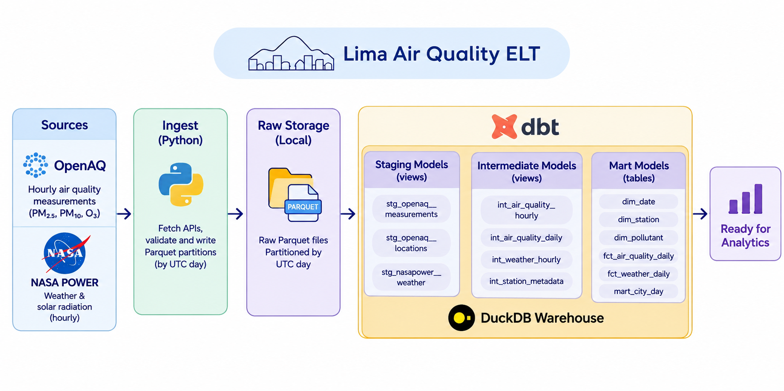
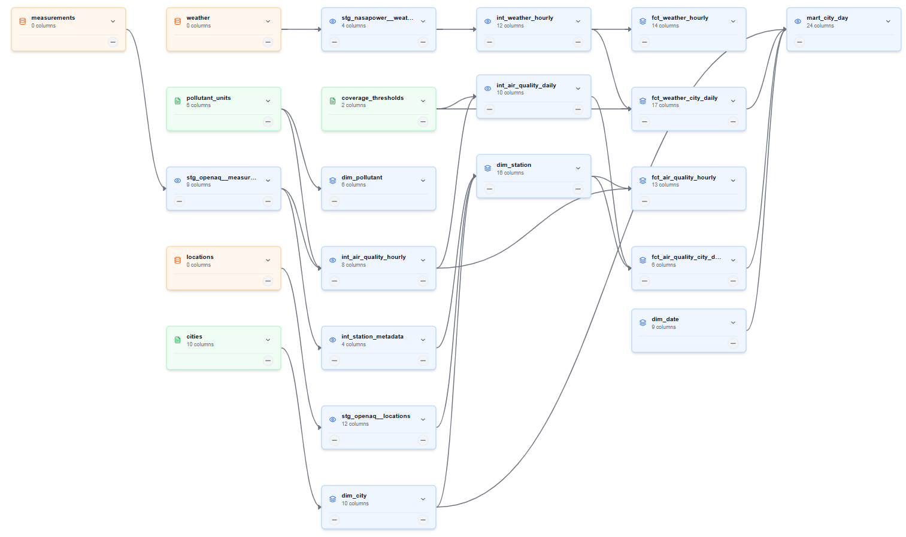

# Lima Air Quality ELT

[Spanish version (español)](README.es.md)

A local ELT pipeline that combines street-level air quality measurements from OpenAQ with NASA POWER weather and solar radiation, and publishes a city-day star schema in DuckDB through dbt. The deliverable is the data model itself: dimensions, facts, tests and executable documentation.



## Research questions

1. How do ozone and particulate matter levels vary on days with different solar radiation?
2. How do meteorological conditions (wind, humidity, temperature, precipitation, pressure) relate to particulate matter?

Both are answered at the **city-day grain** for Metropolitan Lima: the pollution of the city as a whole (equal-weight mean across stations that pass a coverage threshold) against one NASA POWER exposure point, because a single grid cell covers the whole city.

## Pipeline architecture

| Stage | Layer | What happens |
|---|---|---|
| **Ingest** (Python) | Bronze | Fetches the APIs, validates and writes one Parquet partition per UTC day under `data/raw`. The raw layer keeps the API responses as-is in a `payload` column. Re-running a day atomically replaces only that partition. |
| **Transform** (dbt) | Silver | Staging flattens the payloads into typed views. Intermediate applies the business rules: sensor selection, physical validity and coverage. Staging and intermediate are views. |
| **Publish** (dbt) | Gold | Tables rebuilt on every `dbt build`: conformed dimensions, hourly facts, city-daily aggregate facts and one serving view. `mart_city_day` is the only serving view. |

`dbt build` runs seeds, models and tests in dependency order. There are no incremental models: every table is rebuilt from the raw layer.

## Project structure

```
proj/
|-- src/
|   |-- main.py                 # CLI entrypoint and run orchestration
|   |-- ingest.py               # discovery, OpenAQ and NASA POWER ingestion
|   `-- exceptions.py           # failures and exit codes
|-- dbt/
|   |-- dbt_project.yml
|   |-- profiles.yml
|   |-- macros/
|   |   `-- generate_schema_name.sql
|   |-- seeds/
|   |   |-- cities.csv
|   |   |-- coverage_thresholds.csv
|   |   `-- pollutant_units.csv
|   |-- models/
|   |   |-- staging/            # views: one model per source
|   |   |-- intermediate/       # views: cleaning, joins and business rules
|   |   `-- marts/              # dimensions, facts and the serving view
|   `-- tests/                  # singular dbt tests
|-- tests/
|   |-- conftest.py             # adds src/ to the pytest path
|   `-- test_ingest_discovery.py
|
|-- data/
|   |-- raw/                    # Parquet partitions and the locations snapshot
|   |-- _state/                 # ingestion logs
|   `-- warehouse.duckdb        # local analytical database
|-- images/
|-- pyproject.toml
`-- README.md
```

## Sources

| Source | What it provides | Notes |
|---|---|---|
| [OpenAQ v3](https://docs.openaq.org/) | Hourly measurements per sensor (`pm25`, `pm10`, `o3`) from fixed stations inside the Lima bounding box, plus the locations catalog refreshed every run | API key required (`OPENAQ_API_KEY`). Sensors report in `ug/m3` and `ppm`; staging normalizes everything to `ug/m3`. All sensors of each enabled pollutant are ingested, and dbt selects one per station, pollutant and hour. Dead sensors stay in the catalog: liveness is a property of the data, not of the catalog. |
| [NASA POWER](https://power.larc.nasa.gov/) | Hourly city-point weather: all-sky and clear-sky shortwave radiation, temperature, dew point, relative humidity, wind speed and direction, precipitation, surface pressure | No key needed. One request per day for the single city point. Fill values (`-999.0`) are kept in raw and nulled in staging. |

Lag matters: NASA POWER meteorology publishes in about 3 days but its hourly radiation (CERES) takes about 2 months, so `INGEST_LAG_DAYS=70` by default. A partition is only ingested once every variable of that day is final.

## Configuration

The project has two configuration surfaces:

1. The **dbt VS Code extension** reads its environment variables from `lima-air-quality-elt.code-workspace`, under `dbt.environmentVariables`. Open that workspace file, not only the repository folder, so the extension loads them.
2. The **ingestion CLI** reads `.env` (ignored by git) and falls back to the process environment. Only the ingestion needs the API key.

| Variable | Required | Where to set it | Default | Purpose |
|---|---|---|---|---|
| `OPENAQ_API_KEY` | yes | `.env` | - | OpenAQ authentication. Only the ingestion uses it. |
| `RAW_ROOT` | no | `.env` and workspace | `data/raw` | Raw Parquet root, shared by ingestion and dbt sources. |
| `DUCKDB_PATH` | no | `.env` and workspace | `data/warehouse.duckdb` | Local DuckDB file used by dbt. |
| `INGEST_LAG_DAYS` | no | `.env` | `70` | Minimum age of a day before NASA POWER is considered final. |
| `DBT_PROFILES_DIR` | no | workspace | - | dbt extension profile directory. The CLI commands already pass `--profiles-dir dbt`. |

The workspace file is committed with absolute paths for the original checkout. Edit these values for your machine:

```json
"dbt.dbtMajorVersion": "v2",
"dbt.profileName": "lima_air_quality",
"dbt.targetName": "dev",
"dbt.environmentVariables": {
  "DBT_PROFILES_DIR": "<repo>/dbt",
  "DUCKDB_PATH": "<repo>/data/warehouse.duckdb",
  "RAW_ROOT": "<repo>/data/raw"
}
```

`OPENAQ_API_KEY` is intentionally not in the workspace file: that file is tracked and the key is a secret. Put it in `.env`, which is ignored by git. If you want a single entry point, keep an untracked local copy of the workspace file with the key included, but never commit that copy.

Copy `.env.example` to `.env` and fill `OPENAQ_API_KEY`. The rest of the defaults work for a local checkout. Keep the `RAW_ROOT` and `DUCKDB_PATH` values aligned between `.env` and the workspace file.

dbt lives in `dbt/` and uses `dbt/profiles.yml` (inside the repo, not `~/.dbt`). The folder-level schemas are `staging`, `intermediate` and `marts`; the `generate_schema_name` macro keeps those names instead of prefixing them with the profile schema.

Seeds are policy: pollutant ranges and canonical units, coverage thresholds, and the city registry. Edit the CSV and rebuild; the next `dbt build` recomputes the affected history.

Two dbt vars control the model: `date_spine_start` and `date_spine_end` define the calendar spine, and `min_city_stations` (default 8) sets the minimum number of stations for a valid city day.

## Running it locally

Prerequisites:

- [uv](https://docs.astral.sh/uv/)
- Python >= 3.12 (uv manages the environment)
- An [OpenAQ API key](https://openaq.org/)
- VS Code with the dbt extension, opening `lima-air-quality-elt.code-workspace` (not only the repository folder) so the extension loads the dbt environment variables
- Optional: a DuckDB client for exploration

dbt is installed by `uv sync`; the project targets dbt 2.0.9.

```bash
# 1. Clone and install the locked environment
git clone https://github.com/darhr/lima-air-quality-elt.git
cd lima-air-quality-elt
uv sync

# 2. Open the workspace in VS Code (required for the dbt extension)
code lima-air-quality-elt.code-workspace
# Or: File > Open Workspace from File...

# 3. Configure the OpenAQ key for the ingestion CLI
cp .env.example .env
# PowerShell: Copy-Item .env.example .env

# 4. Ingest history, one UTC day or an inclusive range
uv run poe ingest 2025-10-10
uv run poe ingest-range 2025-01-01 2025-03-31

# 5. Build the warehouse: seeds, models and tests
uv run poe build

# 6. Generate documentation and the lineage dashboard
uv run poe docs       # dbt docs + catalog.json -> dbt/target/index.html
uv run poe lineage    # column-level lineage -> dist/index.html
```

The dbt extension needs the workspace file because that is where `dbt.environmentVariables`, `dbt.profileName` and `dbt.targetName` are defined. The terminal commands work from the repository root with or without the workspace file.

Useful raw commands, equivalent to the tasks:

```bash
uv run python src/main.py --date 2025-10-10 --source openaq
uv run dbt run --project-dir dbt --profiles-dir dbt
uv run dbt test --project-dir dbt --profiles-dir dbt
uv run pytest -q
uv run ruff check src tests
```

## dbt models

### Full lineage



### Staging (silver, views)

| Model | Grain | Purpose |
|---|---|---|
| `stg_openaq__locations` | location | The OpenAQ catalog snapshot as typed columns: the metadata source of `dim_station`. The snapshot is deduplicated by `location_id`. |
| `stg_openaq__measurements` | sensor-hour | Flattens the payload JSON: UTC timestamps cast, values kept, o3 ppm converted to `ug/m3`. Carries the station name so metadata can survive catalog removals. |
| `stg_nasapower__weather` | city-variable-hour | Unrolls the per-variable JSON maps into long format; fill values become NULL. The pivot to one row per hour happens in the intermediate layer. |

### Intermediate (silver, views)

| Model | Grain | Purpose |
|---|---|---|
| `int_air_quality_hourly` | station-pollutant-hour | One sensor per hour: the one with the highest coverage wins, with ties broken by sensor id. Flags values outside the seed's physical range as `is_valid = false`. Local time attributes are added later, in the fact. |
| `int_air_quality_daily` | station-pollutant-day | Aggregates valid hours only and applies the coverage rule (>= 75% of 24 hours from the `coverage_thresholds` seed), so the city layer never weighs an incomplete station day. |
| `int_station_metadata` | location | Every station observed in the measurements, with its latest name and first/last measured hour: the data-driven base of `dim_station`. |
| `int_weather_hourly` | city-hour | Hourly weather with a physical validity flag: every variable must be present and in range, so a missing variable (a fill) invalidates the hour. |

### Marts (gold)

| Model | Type | Grain | Purpose |
|---|---|---|---|
| `dim_city` | table | city | City registry with the NASA POWER point and the bounding box used to assign stations. From the `cities` seed. |
| `dim_date` | table | date | UTC calendar spine with calendar attributes (year, month, weekend flag). |
| `dim_hour` | table | hour 0-23 | Conformed hour dimension shared by the hourly facts. |
| `dim_pollutant` | table | pollutant | Canonical unit and physical validity range per pollutant. From the `pollutant_units` seed. |
| `dim_station` | table | station | Every station observed in the data, enriched with the current catalog. Stations removed from OpenAQ survive while their raw partitions exist; `is_in_catalog` marks the difference. A removed station never orphans its facts. |
| `fct_air_quality_hourly` | table | station-pollutant-hour | Atomic air quality fact with the selected sensor, validity flag and local date/hour. |
| `fct_weather_hourly` | table | city-hour | Atomic weather fact, pivoted to one column per variable. |
| `fct_air_quality_city_daily` | table | city-pollutant-day | Aggregate fact: equal-weight mean of the station daily means that passed coverage, with `n_stations` and the `min_city_stations` validity flag protecting against composition bias. |
| `fct_weather_city_daily` | table | city-day | Daily weather: radiation sums (all-sky and clear-sky) in MJ/m2, temperature/dew/humidity/pressure means, wind speed and dominant direction (circular mean), precipitation. |
| `mart_city_day` | view | city-pollutant-day | Serving view: air quality left joined to weather by city and date, with validity flags. Both research questions are queries over this view. |

## Semantic model

The marts form four star schemas that share conformed dimensions. The dbt DAG shows build order, it doesn't represent star schema conformation. Fact table dimensions are built with contracts between models.

| Star | Fact | Grain | Dimensions | Main use |
|---|---|---|---|---|
| Air quality hourly | `fct_air_quality_hourly` | station-pollutant-hour | `dim_station`, `dim_pollutant`, `dim_city`, `dim_date`, `dim_hour` | Station-level analysis, sensor selection audit, local-time profiles. |
| Weather hourly | `fct_weather_hourly` | city-hour | `dim_city`, `dim_date`, `dim_hour` | Hourly exposure context and the base for daily weather aggregates. |
| Air quality city-day | `fct_air_quality_city_daily` | city-pollutant-day | `dim_city`, `dim_pollutant`, `dim_date` | Compares city pollution across days, with coverage and station-count guards. |
| Weather city-day | `fct_weather_city_daily` | city-day | `dim_city`, `dim_date` | Daily radiation, temperature, wind and humidity for both research questions. |

### Star 1 - Air quality hourly

```
        dim_date      dim_hour
              \        /
dim_station --- fct_air_quality_hourly --- dim_pollutant
                     |
                  dim_city
```

This is the most granular star. It answers "what did this station measure at this hour?" and keeps the selected sensor and the validity flag. `city_id` is available directly and also through `dim_station`, so a semantic layer should pick one canonical path to `dim_city`.

### Star 2 - Weather hourly

```
dim_date --- fct_weather_hourly --- dim_city
                  |
               dim_hour
```

This star answers "what was the city exposure at this hour?". Weather is a single point per city, so there is no station or pollutant dimension here. It feeds the daily weather aggregate.

### Star 3 - Air quality city-day

```
dim_date --- fct_air_quality_city_daily --- dim_city
                    |
              dim_pollutant
```

This aggregate star answers "how polluted was the city on this day, for this pollutant?". The value is the equal-weight mean of the station daily means that passed coverage. `n_stations` and `is_valid_city_day` make the sample size and validity explicit.

### Star 4 - Weather city-day

```
dim_date --- fct_weather_city_daily --- dim_city
```

This aggregate star answers "what were the daily weather conditions for the city?". Radiation is summed to MJ/m2, temperatures use mean/min/max, and wind direction uses a circular mean.

### Conformed dimensions and the serving view

`dim_city` and `dim_date` are shared by all four stars. `dim_hour` is shared by the two hourly stars. `dim_pollutant` is shared by the two air quality stars. This is a fact constellation, not one huge star.

`mart_city_day` drills across Star 3 and Star 4 by `city_id` and `date_key`. It is a serving view, not a new star.

## Tests and data quality

`dbt build` runs the full test suite after seeds and models. The tests are intentionally split by purpose.

### Generic dbt tests

| Test | Where it is used | What it protects |
|---|---|---|
| `not_null` | Keys, grain, required dimension attributes, computed flags and counts | A null there would break the grain, a join or the meaning of the row. |
| `accepted_values` | Pollutant codes, NASA POWER variables, city id and seed keys | Only the supported domain reaches the model. |
| `relationships` | Facts and marts to `dim_station`, `dim_pollutant`, `dim_city`, `dim_date`, `dim_hour` | No orphan keys and no broken star joins. |
| `unique` | Seed keys (`pollutant_units.pollutant`, `cities.city_id`, `coverage_thresholds.scope`) | No duplicated policy rows. |

Nulls are part of the contract, not automatically an error. Measures and optional metadata are nullable by design: an unknown unit, missing coverage, a NASA POWER fill, a day without valid hours, or the metadata of a station removed from the catalog. `not_null` is reserved for keys, grain and attributes without which a row cannot be interpreted.

### Singular dbt tests

| Group | Tests | What they protect |
|---|---|---|
| Uniqueness | `assert_snapshot_unique_location`, `assert_unique_stg_measurements_sensor_hour`, `assert_unique_dim_*`, `assert_unique_fct_*` | One row per natural key and per declared fact grain. |
| Completeness | `assert_power_parameters_aligned`, `assert_weather_hour_complete` | Every city-hour has the 9 NASA POWER variables, with no missing or duplicated rows. |
| Units and time | `assert_unknown_unit`, `assert_local_time_conversion` | Unsupported units are detected instead of mislabeled, and UTC to local conversion uses the correct argument order. |
| Business rules | `assert_daily_coverage_bounds`, `assert_station_has_city`, `assert_city_day_station_threshold` | Coverage stays in 0-100, every station and air quality fact has a city, and the city validity flag matches `min_city_stations`. |

The Python tests cover the ingestion discovery logic: location deduplication, retention of every sensor for a pollutant, and that every discovered sensor is requested.

```bash
uv run poe build                              # seeds + models + dbt tests
uv run dbt test --project-dir dbt --profiles-dir dbt
uv run pytest -q                              # ingestion unit tests
uv run ruff check src tests
```

## Limits and design decisions

- **UTC days.** Facts and daily aggregates use UTC dates. `local_date` and `local_hour` live in `fct_air_quality_hourly` as attributes derived from the station timezone; they are not dimensions.
- **One weather point per city.** NASA POWER exposure is a single city point, not a station-level measurement. Weather cannot be interpreted as local variation inside Lima.
- **Type 1 dimensions.** Dimensions are rebuilt completely on every `dbt build`. There is no SCD2, no `dbt snapshot` and no history. A change in station name, timezone, city or coordinates is applied retroactively to the whole history. Source metadata changes leave no history; seed changes are audited in git.
- **No imputation.** Missing measurements stay missing. Fill values become NULL, invalid values stay visible with `is_valid = false`, and coverage is reported instead of hidden.
- **Equal weight per station.** The city mean is the mean of the station daily means that passed coverage, not a mean of hours and not a weighted mean. A city day is flagged invalid when fewer than `min_city_stations` stations contribute.
- **Single-city fallback.** With one city, stations that lose their catalog metadata still get `city_id` and a timezone so their historical days reach the city mart. With multiple cities, that fallback is disabled and those stations need an explicit spatial assignment.
- **Raw is source-aligned.** Units, fill values and physical ranges are not fixed in the raw layer. Normalization, validity and coverage live in dbt.

## Attribution and licenses

Air quality data comes from [OpenAQ](https://openaq.org/); weather and solar radiation come from [NASA POWER](https://power.larc.nasa.gov/). Each source has its own terms of use. The per-station licenses returned by OpenAQ are stored as JSON in `dim_station.licenses`; review them before redistributing station-level data.
